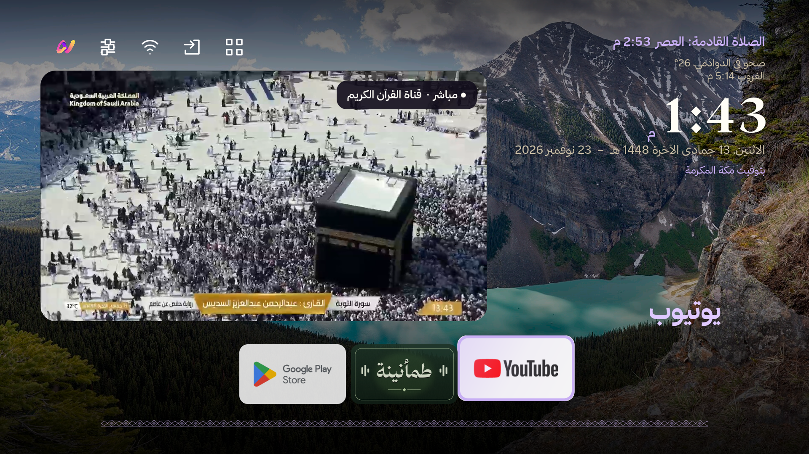
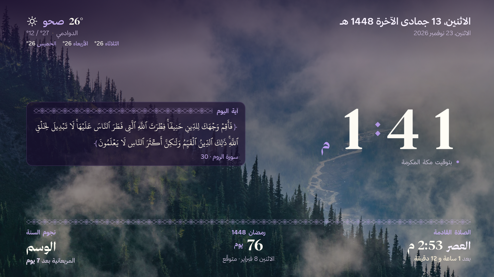
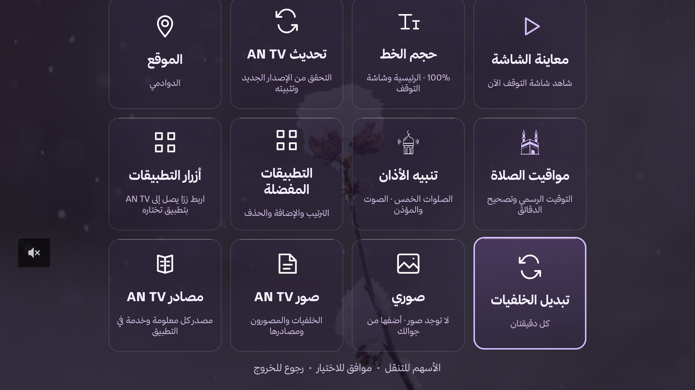

<h1 align="center">AN TV</h1>

واجهة عربية خاصة لتلفزيونات Android TV وGoogle TV — هوية خزامى وزجاج ونقش سدو وخط ثمانية.

## الواجهة الرئيسية

بث مباشر لقناة القرآن الكريم، التطبيقات المفضلة، الساعة والتاريخ، الصلاة القادمة والطقس.

## شاشة التوقف

آية أو حديث اليوم، الساعة بتوقيت مكة، الصلاة القادمة، المناسبات ونجوم السنة، وخلفيات طبيعة وحيوانات. أسماء المصورين ومصادر الخلفيات داخل الإعدادات.

## إعدادات AN TV

اختيار المدينة، مواقيت الصلاة، تنبيه الأذان ومعاينته، حجم الخط، المفضلة، الخلفيات وصوري ومصادر المعلومات والتحديثات.

## التجهيز من التلفزيون

فعّل تصحيح USB أول مرة، وثبّت AN TV برمز Downloader **1982161**، ثم افتحه واضغط **جهّز كل شيء**. وافق على رسالة التصحيح، وراجع الخطة ثم ابدأ. زر **تراجع** يستعيد الرئيسية وشاشة التوقف السابقة. المساعدة والاقتران اللاسلكي متاحان عند الحاجة.

## التثبيت والتحديث

[صفحة الشرح والتحميل](https://aij17.github.io/AN-TV-Installer/) · رمز Downloader: **1982161**.

AN TV يصبح الواجهة الرئيسية وشاشة التوقف بعد نجاح التفعيل وموافقات الجهاز. نظام Android وتطبيقاته يبقون موجودين. يحفظ معالج التفعيل اختيارات الرئيسية وشاشة التوقف ومدة الخمول السابقة للاستعادة؛ هذه ليست نسخة احتياطية كاملة للنظام. تختلف إمكانات التصحيح بحسب الجهاز.

[دليل التثبيت التفصيلي: التلفزيون والجوال والكمبيوتر والأوقات والاستعادة](docs/AN-TV-INSTALL.md)

## التلاوات والمؤذنون

طمأنينة هو مدخل التلاوات في واجهتنا. التلاوات قسم مستقل عن أصوات الأذان. التلاوات وأسماء القراء تُقرأ من ملفات `quran/reciters.json`، والتسجيلات من MP3Quran. أسماء السور من AlQuran Cloud. أصوات المؤذنين من المصادر الموثقة داخل بيانات الحزمة، ومنها Archive.org. صفحة «تنبيه الأذان» تختص بالمؤذن والصوت والمعاينة.

## التحميل والكود

رمز Downloader: **1982161**. [تحميل أحدث إصدار](https://github.com/aij17/AN-TV-Installer/releases/latest/download/AN-TV.apk).

هذا المستودع العام مخصص للشرح وملفات التثبيت. كود AN TV في مستودع AN-TV-Source الخاص. تراخيص المكونات الأصلية محفوظة في الحزمة.
